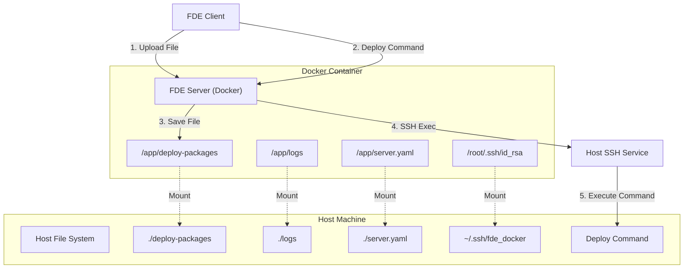

# FDE Server Docker 部署

## 1. 环境准备 (SSH Key 配置)

为了让 Docker 容器内的 FDE Server 能够操作宿主机（例如重启 Docker 容器、执行系统命令），我们需要配置 SSH 互信。

宿主机应使用权限受限的专用部署账号（下文使用 `fde-deploy`），不要授权通用 root shell。部署账号只授予实际部署命令需要的目录和服务权限。

### 1.1 生成 SSH Key (在宿主机执行)

```shell
# 生成 key (无密码)
ssh-keygen -t rsa -b 4096 -f ~/.ssh/fde_docker -N ""

# 添加 key 到 authorized_keys
cat ~/.ssh/fde_docker.pub >> ~/.ssh/authorized_keys
chmod 600 ~/.ssh/authorized_keys

# 检查是否配置成功，如果成功会输出 Success
ssh -i ~/.ssh/fde_docker fde-deploy@127.0.0.1 echo "Success"
```

### 1.2 构建/加载镜像 (可选)

如果你需要手动构建或加载镜像：

```shell
# 构建镜像 (x86)
docker build --platform linux/amd64 -t yuchenii/fde-server:latest .

# 构建镜像 (arm64)
docker build --platform linux/arm64 -t yuchenii/fde-server:latest .

# 构建多架构镜像并推送
docker buildx build --platform linux/amd64,linux/arm64 -t yuchenii/fde-server:latest -t yuchenii/fde-server:v1.2.0 --push .

# 或者加载离线镜像
docker load -i ./fde-server.tar
```

## 2. 服务端目录结构

容器内部的关键目录结构如下，server.yaml 中的 uploadPath 需要与挂载的 deploy-packages 目录一致：

```
/app
├── server.yaml       # [配置文件] 核心配置
├── logs/             # [日志目录] 存放运行日志
│   └── fde-server.log
├── deploy-packages/  # [部署目录] 存放上传的构建产物
│   ├── test/
│   └── prod/
└── ... (Server 代码)
```

## 3. 部署配置

### 3.1 Docker Run

使用 `docker run` 快速启动，注意挂载刚才生成的 SSH Key：

```bash
docker run -d \
  --name fde-server \
  -p 3000:3000 \
  -v "./server.yaml:/app/server.yaml:ro" \
  -v "${HOME}/.ssh/fde_docker:/root/.ssh/id_rsa:ro" \
  -v "./deploy-packages:/app/deploy-packages" \
  -v "./logs:/app/logs" \
  -e SSH_USER=fde-deploy \
  -e SSH_HOST=host.docker.internal \
  -e SSH_PORT=22 \
  -e HOST_CONFIG_DIR="$(pwd)" \
  -e TZ=Asia/Shanghai \
  --add-host host.docker.internal:host-gateway \
  yuchenii/fde-server:latest
```

上例适用于可信内网直连。若同一宿主机上的 Nginx 提供 TLS 入口，请把端口参数改为 `-p 127.0.0.1:3000:3000`。

### 3.2 Docker Compose (推荐)

创建 `docker-compose.yml`：

```yaml
services:
  fde-server:
    image: yuchenii/fde-server:latest
    container_name: fde-server

    # For docker to connect to host machine
    extra_hosts:
      - host.docker.internal:host-gateway

    ports:
      # 可信内网直连；同机 TLS 反向代理请改为 127.0.0.1:3000:3000
      - 3000:3000

    volumes:
      # Server config
      - ./server.yaml:/app/server.yaml:ro
      # SSH key for docker to connect to host machine
      - ${HOME}/.ssh/fde_docker:/root/.ssh/id_rsa:ro
      # Deploy packages, must be same as uploadPath in server.yaml
      - ./deploy-packages:/app/deploy-packages
      # Logs
      - ./logs:/app/logs

    environment:
      # Dedicated deployment user on the host machine
      - SSH_USER=fde-deploy
      # Change to your host docker gateway ip, usually 172.17.0.1
      - SSH_HOST=host.docker.internal
      # Change to your host machine ssh port
      - SSH_PORT=22
      # Server config path, used to resolve relative paths in deployCommand
      - HOST_CONFIG_DIR=/data/projects/app
      - TZ=Asia/Shanghai

    restart: unless-stopped
```

### 3.3 配置文件 (server.yaml)

`server.yaml` 是 FDE Server 的核心配置文件。

路径解析：[Path Resolution](path-resolution.md#docker-environment)

```yaml
# 服务器端口
port: 3000

# 全局认证 Token（可选，如果环境配置中未指定则使用此 Token, 可使用 `openssl rand -hex 32` 生成）
token: "<64-hex-token>"

# 日志配置
log:
  path: "./logs/fde-server.log" # Docker 内通常不需要修改，默认 /app/logs/...
  maxSize: 10 # MB
  maxBackups: 5

# 上传、解压与部署冷却限制（容量单位：MB；deployCooldownSec 为秒）
limits:
  chunkStorageMB: 10240 # 分片总配额，10 GiB
  chunkFileMB: 10240 # 单文件上限，不能超过总配额
  zipExtractMB: 2048 # ZIP 解压后总大小，2 GiB
  deployCooldownSec: 30 # 部署结束后拒绝新部署的冷却秒数（0 关闭）

# 环境配置
environments:
  # 测试环境
  test:
    token: "<test-64-hex-token>" # 覆盖全局 Token
    uploadPath: "./deploy-packages/test" # 部署包路径
    deployCommand: "./scripts/deploy-test.sh" # 部署脚本或命令

  # 生产环境
  prod:
    token: "<prod-64-hex-token>"
    uploadPath: "./deploy-packages/prod"
    deployCommand: "./scripts/deploy-prod.sh"
```

### 3.4 网络安全

- `http://` 只适用于可信私网。
- 公网或其他不可信网络必须由 TLS 反向代理提供 `https://` 入口。
- 反向代理和 FDE 在同一台主机时，建议把容器端口绑定到 `127.0.0.1`。
- 应用会按来源地址限制认证失败次数，并在请求包含 `X-Real-IP` 时读取该地址。Nginx 应配置 `proxy_set_header X-Real-IP $remote_addr;` 覆盖客户端传入值，并禁止客户端绕过代理直连 FDE。
- 当前关闭 SSH 主机校验的实现只适用于容器通过 `host.docker.internal` 连接同一台宿主机，不应把 `SSH_HOST` 指向远程主机。

## 4. 架构与原理

FDE Server 在 Docker 中运行的核心原理是通过 **Volume 挂载** 实现文件共享，通过 **SSH** 实现宿主机控制。

### 4.1 架构图



### 4.2 核心流程解析

1.  **文件挂载 (Mounting)**:

    - 客户端上传的文件被保存到容器内的 `/app/deploy-packages`。
    - 由于配置了 Volume (`./deploy-packages:/app/deploy-packages`)，文件实际被写入到了宿主机的对应目录。
    - 这确保了即使容器销毁，部署包依然存在，且宿主机上的其他服务（如 Nginx）可以直接访问这些静态文件。

2.  **命令执行 (Execution)**:
    - 当 Server 接收到部署命令时，它需要操作宿主机资源（例如 `docker restart`）。
    - Server 读取挂载进来的 SSH 私钥 (`/root/.ssh/id_rsa`)。
    - Server 通过 SSH 连接到 `SSH_HOST` (即宿主机)。
    - Server 在宿主机上执行 `cd HOST_CONFIG_DIR && <deploy_command>`。
    - 这样就实现了在容器内安全地控制宿主机环境。
